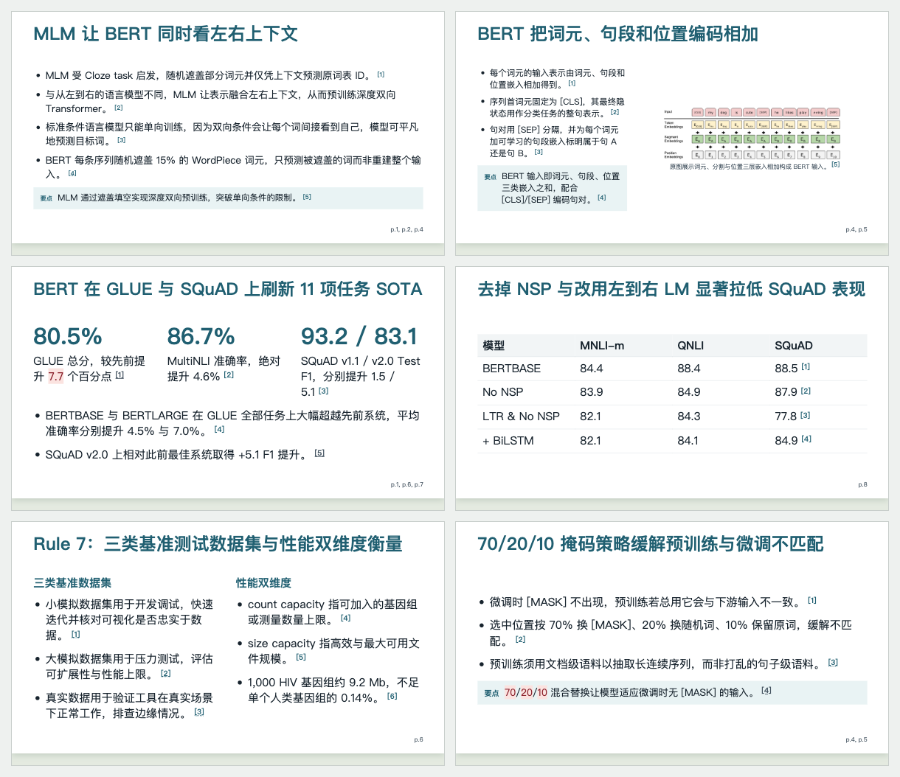
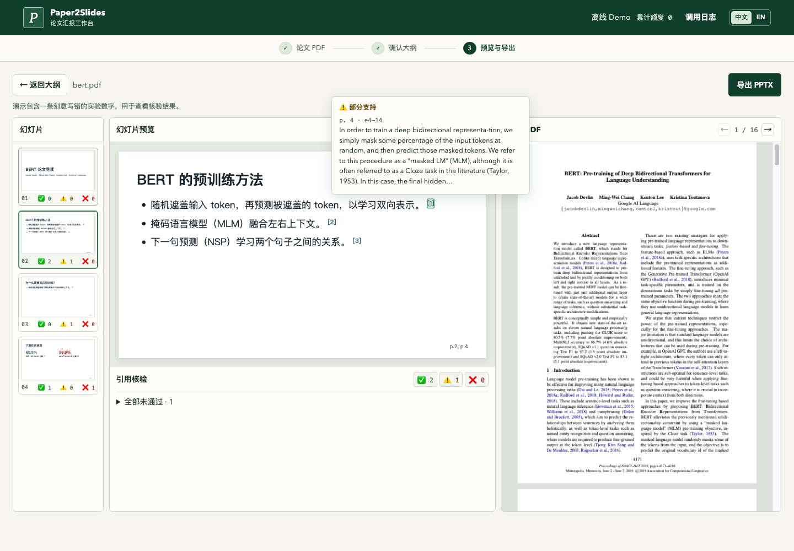
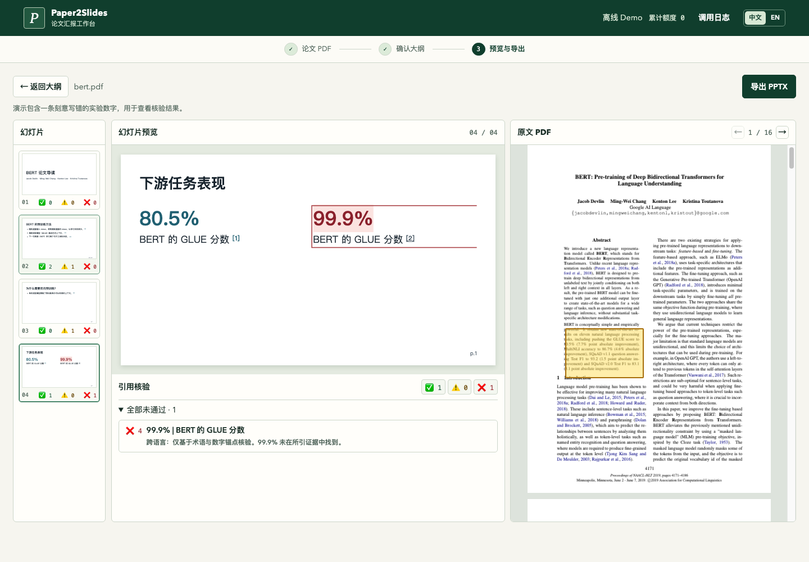

<div align="center">

# Paper2Slides

**上传一篇论文 PDF，生成每句话有出处、每个数字经过核验的组会汇报 PPT。**

一个运行在 [Anna](https://staging.anna.partners) 平台上的 Anna App · slug `paper2slides`

[设计文档](docs/DESIGN.md) · [评测报告](eval/grounding/REPORT.md) · [提示词与迭代记录](prompts/README.md) · [交接文档](docs/HANDOFF.md)

</div>



<sub>以上 6 页均为真实模型（`xiaomi/mimo-v2.5`）生成、未经人工修改：BERT（前 4 页）、冷门论文《基因组可视化十条规则》、以及把 BERT 关键数字篡改后的 PDF（右下，模型照搬了篡改值 70/20/10）。</sub>

## 为什么做这个

学术汇报最怕的不是排版丑，而是**数字错**：把 baseline 的结果当成本文结果、把 80.5 记成 85.0。通用 PPT 生成器擅长视觉和全流程，但不告诉你每句话从哪来。

Paper2Slides 只做一件事，并把它做深：**论文场景下的事实准确与可追溯**。

| | 通用 AI PPT 生成器 | Paper2Slides |
|---|---|---|
| 输入 | 任意主题 | 单篇论文 PDF |
| 内容来源 | 模型生成，可联网 | 只来自上传的 PDF |
| 出处 | 无逐句出处 | 每条要点带角标，悬停看原文，点击跳到 PDF 高亮 |
| 数字 | 不核验 | 代码核验：数字必须原样出现在所引原文中 |
| 结构 | 通用模板 | 按论文实际包含的内容模块组织，没有实验就不生成实验页 |

## 功能

- **引用气泡**：每条要点都有 `[n]` 角标，悬停显示原文片段、页码和核验状态，点击在右侧 PDF 中定位。
- **三级核验**：✅ 原文支持 / ⚠️ 部分支持 / ❌ 无出处。全部由确定性代码完成，不消耗额度；不静默删除，而是标出来让人判断。
- **跨语言核验**：英文论文生成中文 PPT 时，用术语、数字、数词（eleven ↔ 11）、百分点等锚点核对。
- **论文原图**：按图注定位并截取原图（矢量图也可以），截取失败时降级为文字引用，不放错图。
- **6 种学术版式**：封面、要点、要点 + 原图、左右对比、关键数字、结果表格。模型只选版式、填内容，代码负责摆放。
- **大纲可编辑**：先确认大纲（可改标题、调顺序、删页，可选「方法优先 / 实验优先」），再逐页生成。
- **讲稿**：每页 2–4 句口语化讲稿，写入 PPTX 演讲者备注。
- **PPTX 导出**：预览与导出共用同一套测量结果，引用在 PPTX 中降级为页角 `p.N`，完整引文写入备注。
- **调用日志**：每次 AI 调用的原始输出、额度、耗时和自动修正都可查看、导出。

<table>
<tr>
<td width="50%"></td>
<td width="50%"></td>
</tr>
<tr>
<td align="center"><sub>悬停角标查看原文、页码与核验状态</sub></td>
<td align="center"><sub>Demo 中故意写错的 99.9% 被标为 ❌，PDF 中高亮对应原文</sub></td>
</tr>
</table>

## 使用

1. 在 Anna 中安装 **Paper2Slides**，打开 App。
2. 上传论文 PDF（需带文字层，扫描版会提示）。
3. 点「理解论文并生成大纲」，确认或修改大纲。
4. 点「生成幻灯片」，在预览中查看引用和核验结果。
5. 点「导出 PPTX」。

> [!TIP]
> 不想花额度时，点「试用 BERT Demo」可零额度体验完整界面。

一篇 10 页左右的汇报实测需要 **11–21 次 AI 调用、约 7–10 额度、2–3 分钟**（见下方评测）。

## 工作原理

```text
上传 PDF ─► 浏览器解析 ─► 理解论文 ─► 确认大纲 ─► 逐页生成 ─► 核验 ─► 预览/排版 ─► 导出 PPTX
            pdf.js       AI ×1       AI ×1       检索+AI×N    纯代码    CSS 测量     pptxgenjs
```

### 核心设计判断

**1. 单篇论文不用 RAG 解决「装不下」。** 一篇论文 10k–25k tokens，整篇放进上下文比切块召回更能保留跨章节逻辑。实测整篇 BERT（13.4k tokens）一次理解只花约 1.6 额度。检索用在别处：给每页收窄证据范围、把陈述锚定到原文、做核验。

**2. 混合检索，按规模选型。** BM25（MiniSearch）负责数字、数据集名、模型名这类精确词，向量检索负责语义，RRF 融合。单篇论文只有几百个证据块，浏览器内存里算即可，不用向量库。向量检索默认关闭：平台 embedding 每次调用至少 1 额度、最多 64 条，一篇论文向量化要 5–9 额度，比全部生成还贵。

**3. 准确性由代码保证，不靠模型自觉。** 引用 ID 必须真实存在；要点里的每个数字必须原样出现在它所引用的证据中（处理 `3.2%`/`3.2 %`、`eleven`/`11`、`个百分点`/`% point`、`80/10/10` 这类写法）；每条要点标注 `fact / summary / opinion`，观点必须显式标出。

**4. 模型选版式、填槽位，代码负责摆放。** 调研 PPTAgent、Paper2Poster 和 Anthropic pptx skill 后的共识：没有人让模型直接输出坐标。App 本身运行在浏览器里，直接用 CSS 渲染、测量溢出，按「缩字号 → 压缩该页 → 拆页」降级，再把测量坐标转成 PPTX。

**5. 按内容模块组织，而不是给论文分类。** 理解阶段识别论文实际包含哪些模块（问题、方法、理论、实验、消融、分类体系、局限、未来工作），缺失的模块不出页，从结构上杜绝硬凑。

**6. AI 输出「宽进严出」。** 真实模型总有小偏差：多字段、重复键、少括号、单项写成对象、引用 ID 少连字符。这些自动修正并记入日志，避免白烧额度；但引用 ID、数字和结构性错误必须守住。JSON 容错不用现成修复库，因为它们会把截断的 `80.` 补成 `80`，在核验场景里等于制造假事实。

### 提示词工程

提示词单独放在 [`prompts/*.md`](prompts/)，frontmatter 带版本号，构建时编译成 JS（平台 bundle 不允许 `.md`）。缓存键包含提示词版本，改提示词会自动让对应步骤缓存失效。每次真实模型出错，都把原始输出存为回归 fixture（[`src/llm/fixtures/`](src/llm/fixtures/)），迭代记录见 [`prompts/README.md`](prompts/README.md)。

### 目录

| 目录 | 内容 |
|---|---|
| [`src/parser/`](src/parser/) | pdf.js 解析：阅读顺序、按章节切块、剔除参考文献与页眉页脚、截取原图 |
| [`src/retrieval/`](src/retrieval/) | BM25、向量、RRF 融合 |
| [`src/verify/`](src/verify/) | 引文与数字核验、跨语言锚点、数词与比例识别 |
| [`src/llm/`](src/llm/) | AI 调用、重试、容错解析、真实输出回归 |
| [`src/schema/`](src/schema/) | Valibot 校验与归一化，版式契约 |
| [`src/pipeline/`](src/pipeline/) | 理解 → 大纲 → 逐页，缓存 |
| [`src/layout/`](src/layout/) · [`src/export/`](src/export/) | 版式、溢出检测、PPTX 导出 |
| [`src/ui/`](src/ui/) | 三栏工作台、引用气泡、核验面板、Demo |
| [`prompts/`](prompts/) | 4 个提示词与迭代记录 |
| [`eval/`](eval/) | 评测论文、端到端脚本、真实运行记录与报告 |

## 评测

用真实平台模型 `xiaomi/mimo-v2.5` 端到端测试了 3 篇特点不同的论文，外加一项篡改实验。所有运行的截图、调用日志、核验结果和 PPTX 都在 [`eval/runs/`](eval/runs/)，方法和逐条明细见 [评测报告](eval/grounding/REPORT.md)。

### 内容真的来自 PDF 吗？

核验只能证明「这句话在 PDF 里找得到」，证明不了「它是从 PDF 读出来的」——BERT 太有名，模型凭记忆也能写对。所以做了**篡改实验**：把 BERT PDF 里 7 个广为人知的事实改掉（共 58 处），再走完整流程。

| 事实 | 原值 → 篡改值 | 生成结果 |
|---|---|---|
| 掩码替换比例 | 80/10/10 → 70/20/10 | ✅ 采用篡改值 |
| GLUE 分数 | 80.5 → 78.3 | ✅ 采用篡改值 |
| SQuAD v1.1 F1 | 93.2 → 91.4 | ✅ 采用篡改值 |
| 预训练任务名 | NSP → ASP（Adjacent Segment Prediction） | ✅ 采用篡改值 |
| 掩码比例 15% → 20%、MultiNLI 86.7 → 84.2、L=24 → L=20 | | 未出现在幻灯片中 |

**4 项采用篡改值，0 项回到原值。** 另外人工构造 7 条含原值的陈述送入核验，6 条数字类判 ❌、1 条术语类判 ⚠️——即使模型凭记忆写出原值，核验也能标出来。

### 三篇论文结果

| 论文 | 特点 | 页数 | 引文有效率 | 人工抽查支持率 | 数字准确率（抽查） | 额度 | 耗时 |
|---|---|---:|---:|---:|---:|---:|---:|
| BERT | 知名方法论文 | 10 | 53/53 | — | — | 8.8 | 约 3 分钟 |
| BERT（篡改版） | 篡改实验 | 10 | 53/53 | — | — | 7.8 | 126 秒 |
| 基因组可视化十条规则 | 冷门指南类论文 | 9 | 49/49 | 13/16 | 10/10 | 6.6 | 81 秒 |
| 深度学习系统综述 | 综述，无实验 | 10 | 63/63 | 13/18 | 11/11 | 10.1 | 134 秒 |

- 综述的大纲和成稿都**没有生成实验页或消融页**，也没有出现原文中不存在的数字。
- BERT 正式运行（run7）经逐条审计，核验修正误判后为 ✅37 / ⚠️4 / ❌0，见 [run7 审计](eval/runs/2026-11-21/run7/verify-audit.md)。
- 「人工抽查支持率」指所引原文能完整支撑整句陈述；其余为部分支持（例如漏引了相邻段落）；抽查样本中未发现原文没有依据的陈述。

### 额度记录

开发与评测期间共使用约 **69 / 1000** 额度：平台探针 2.7，首日调试运行 15.7，BERT 端到端 3 次（含 1 次失败）23.0，三项来源评测 27.4（含 1 次失败重试）。每次调用的消耗都记录在调用日志中。

## 已知局限

> [!IMPORTANT]
> 核验是**词面与数字层面**的：它能发现「引用不存在」和「数字在所引原文里找不到」，但不能理解语义。

- **数字对上了，不代表用对了地方。** 核验检查数字是否出现在所引原文中，但不检查它对应的是哪一行、哪一列、哪个指标。评测中出现过表格把真实数字放进错误的列、把困惑度当成参数量，前者仍被判为 ✅。表格页需要人工复核。
- **中文核验偏保守。** 英文论文生成中文 PPT 时，只能靠术语和数字锚点核对，大量正确的要点会被标为 ⚠️：两篇冷门论文中系统判 ✅ 的约 35%，人工复核完整支持的为 72%–81%。⚠️ 表示「建议核对」，不表示内容有误。
- **依赖 PDF 文字层与版式。** 扫描版 PDF 无法处理；三栏、边栏、复杂公式和不规则表格可能出现切块顺序错乱，影响证据定位。
- **模型由平台分配。** App 无法指定模型，生成质量和格式稳定性随平台模型变化；当前已对观察到的格式偏差做了自动修正和回归测试。
- **单篇论文。** 面向单篇精读；超长文档（学位论文、长附录）会降级为分章摘要，效果未充分评测。

## 开发

```bash
npm install
npm test               # 单元与回归测试（真实模型输出 fixture）
npm run build          # 编译提示词 + 类型检查 + 打包到 bundle/
anna-app validate      # 校验 manifest 与 bundle
npm run dev:web        # 纯前端 http://localhost:5173 ，「试用 BERT Demo」零额度
anna-app dev --port 5182 --no-watch   # 本地 harness，连接真实 AI（消耗额度）
```

端到端自动化脚本（上传 → 理解 → 生成 → 逐页截图 → 导出并校验 PPTX）见 [`eval/e2e/README.md`](eval/e2e/README.md)。

技术栈：TypeScript · Vite · pdf.js · MiniSearch · Valibot · pptxgenjs · Floating UI · Vitest。纯前端静态 SPA，所有依赖打包进 bundle，不访问外部域名。
